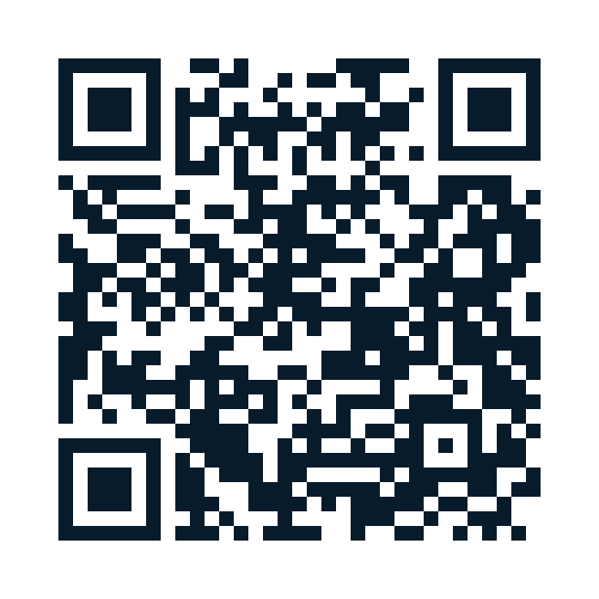
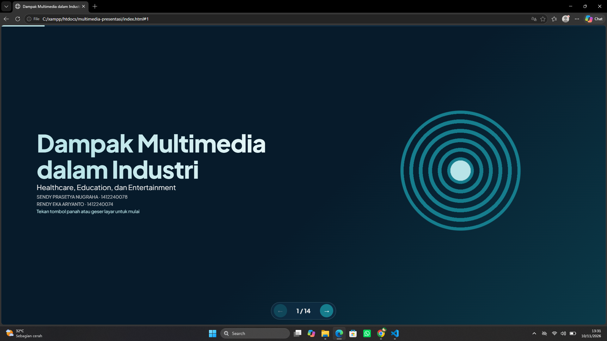
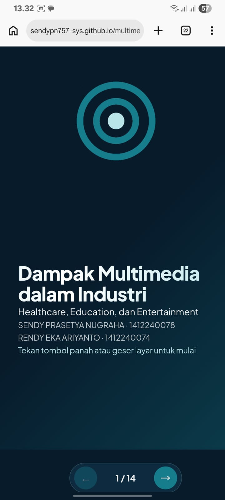
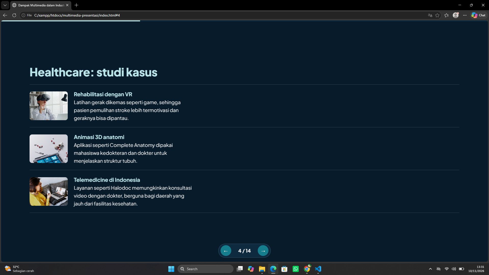
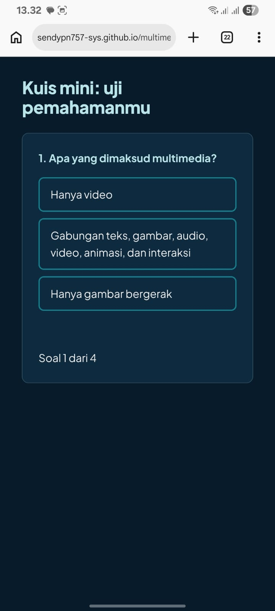
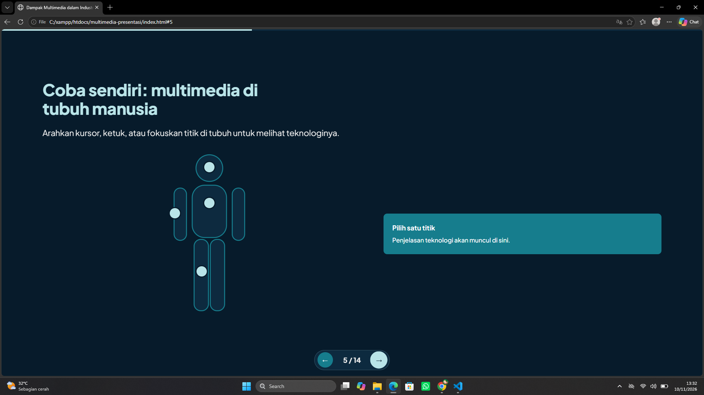
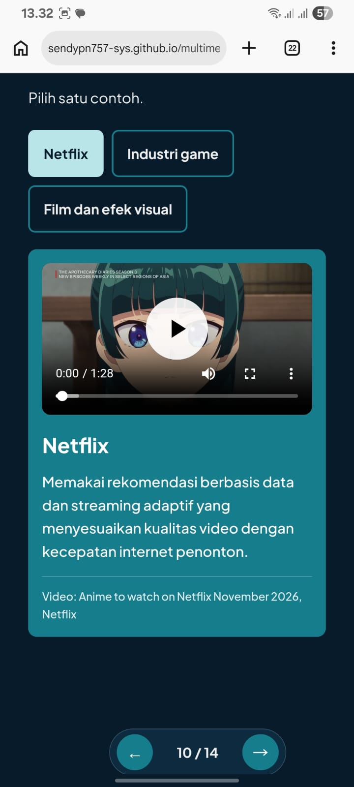

# Dampak Multimedia dalam Industri

Presentasi interaktif berbasis web untuk Proyek UTS Multimedia (IF562528), Universitas PGRI Ronggolawe Tuban. Opsi 1: Presentasi Interaktif.

- **Nama:** Sendy Prasetya Nugraha | **NIM:** 1412240078
- **Nama:** Rendy Eka Ariyanto | **NIM:** 1412240074

**Live:** https://sendypn757-sys.github.io/multimedia-presentasi/


## Deskripsi
Presentasi 14 slide yang membahas dampak multimedia pada tiga industri: Healthcare, Education, dan Entertainment. Dibuat dengan HTML, CSS, dan JavaScript murni tanpa framework, sehingga ringan dan mudah dipelajari. Setiap industri dilengkapi studi kasus nyata, gambar, dan elemen interaktif.

## Topik yang dibahas
1. Pengantar multimedia dan tujuan presentasi
2. Healthcare: ikhtisar, studi kasus, dan titik interaktif pada tubuh manusia
3. Education: ikhtisar, studi kasus, dan kuis mini
4. Entertainment: ikhtisar dan studi kasus dengan tab dan video
5. Perbandingan tiga industri, tren ke depan, kesimpulan, dan referensi

## Cara membuka / menjalankan
- **Online:** buka https://sendypn757-sys.github.io/multimedia-presentasi/ (atau pindai kode QR).
- **Lokal:** unduh repo lalu buka `index.html` di browser. Video YouTube di slide 10 memerlukan koneksi internet.
- **Opsional:** jalankan lewat ekstensi Live Server di VS Code.
- **Navigasi:** tombol panah di layar, keyboard (← →, Home, End), atau geser di layar sentuh.

## Fitur
- Empat elemen interaktif: titik hotspot tubuh (slide 5), kuis 4 soal dengan skor (slide 8), tab studi kasus dengan pemutar video (slide 10), dan toggle perbandingan dampak positif dan tantangan (slide 11)
- Tata letak berbeda di tiap slide: split, bento grid, baris, tab, dan kolom blok warna
- Animasi masuk berurutan, transisi antar slide, progress bar, dan efek hover
- Tiga video YouTube yang disematkan (embed); pemutar baru dimuat saat diklik agar halaman tetap ringan
- Responsif untuk ponsel, tablet, dan desktop
- Aksesibilitas: navigasi keyboard, `alt` text pada gambar, label ARIA, dan dukungan *prefers-reduced-motion*

## Tools
VS Code, Git dan GitHub, GitHub Pages, Color Hunt (palet), Google Fonts (Plus Jakarta Sans), Unsplash (foto), Lighthouse dan WAVE (pengujian).

## Design decisions
- Palet empat warna dari Color Hunt: `#071B2B` (latar), `#167D8D` (aksen), `#B9E4E8` (judul), `#EEEEEE` (teks).
- Satu keluarga font, yaitu Plus Jakarta Sans, untuk menjaga konsistensi.
- Tata letak dibuat bervariasi agar presentasi tidak monoton, sementara warna dan tipografi tetap seragam.
- Navigasi slide ditulis sendiri tanpa library presentasi, agar ukuran kecil dan perilakunya bisa dikendalikan.
- Video disematkan dari YouTube, bukan diunggah ulang, agar repo kecil, halaman cepat dimuat, dan hak cipta tetap pada pemilik kanal.

## Challenges & solutions
- **Layout panel video terlalu kosong dan teks menumpuk di bawah.** Solusi: panel dibagi menjadi dua kolom dengan CSS Grid, video di kiri dan keterangan di kanan, lalu kembali satu kolom di layar kecil.
- **Tampilan slide 10 di HP menampilkan tab dan panel berdampingan sehingga video mengecil.** Solusi: menambahkan aturan *media query* agar di layar sempit tab berada di atas dan panel selebar layar.
- **Video MP4 lokal terasa lambat saat dimuat lewat GitHub Pages.** Solusi: beralih ke video YouTube yang disematkan dan dimuat hanya saat tombol putar ditekan.

## Struktur folder
```
index.html     struktur 14 slide
style.css      tampilan, animasi, dan efek hover
script.js      navigasi, hotspot, kuis, tab video, toggle
images/        gambar slide 4 dan 7
screenshot/   tangkapan layar untuk dokumentasi
```

## Screenshot
Tangkapan layar tampilan desktop dan HP.

| File | Perangkat | Keterangan |
|------|-----------|------------|
|  | Desktop | Slide 1 |
|  | HP | Slide 1 |
|  | Desktop | Slide 4 |
|  | HP | Slide 8 |
|  | Desktop | Slide 5 |
|  | HP | Slide 10 |

## Referensi
1. World Health Organization. (2021). *Global strategy on digital health 2020–2025*. Geneva: WHO. https://www.who.int/publications/i/item/9789240020924. Diakses 9 November 2026.
2. World Health Organization. (2025, 23 Mei). *World Health Assembly endorses extension of the global digital health strategy to 2027*. https://www.who.int/news/item/23-05-2025-world-health-assembly-endorses-extension-of-the-global-digital-health-strategy-to-2027. Diakses 9 November 2026.
3. Laver, K. E., Lange, B., George, S., Deutsch, J. E., Saposnik, G., Chapman, M., & Crotty, M. (2025). Virtual reality for stroke rehabilitation. *Cochrane Database of Systematic Reviews*, Issue 6, CD008349. https://doi.org/10.1002/14651858.CD008349.pub5. Diakses 9 November 2026.
4. UNESCO, Global Education Monitoring Report Team. (2023). *Global Education Monitoring Report 2023: Technology in education, a tool on whose terms?* Paris: UNESCO. https://iite.unesco.org/news/global-education-monitoring-report-2023-technology-in-education-a-tool-on-whose-terms. Diakses 9 November 2026.
5. Netflix Technology Blog. (2026, Agustus). *MAPS: Netflix's multimodal asset personalization at scale*. https://netflixtechblog.com/maps-netflixs-multimodal-asset-personalization-at-scale-32f96320785e. Diakses 9 November 2026.

## Atribusi gambar

**Slide 4 (Healthcare): foto dari Unsplash**

| File | Fotografer | Sumber | Lisensi |
|------|------------|--------|---------|
| images/healthcare-vr.webp | Getty Images | Unsplash, https://unsplash.com/id/foto/dokter-wanita-asia-menggunakan-realitas-virtual-vr-3d-untuk-menganalisis-pemeriksaan-medis-laporan-di-rumah-sakit-kantor-medis-_Q9iw6tQtPQ | Unsplash License |
| images/healthcare-anatomi.webp | 8Machine | Unsplash, https://unsplash.com/id/foto/tablet-dengan-simbol-medis-di-atasnya-dan-stetoskop-di-sebelahnya-gtrQCS8-tzo | Unsplash License |
| images/healthcare-telemedicine.webp | Getty Images | Unsplash, https://unsplash.com/id/foto/pasien-wanita-latin-duduk-di-sofa-di-rumah-melakukan-panggilan-video-dengan-dokter-wanita-online-di-amerika-latin-IpwhZo5dhMQ | Unsplash License |

**Slide 7 (Education): logo dan aset dari press kit resmi**

| File | Pemilik | Sumber | Lisensi |
|------|---------|--------|---------|
| images/edu-ruangguru.jpg | Ruangguru | Press kit Ruangguru, https://ruangguru.com/press | Sesuai ketentuan press kit |
| images/edu-duolingo.webp | Duolingo | Aset pemasaran Duolingo, https://design.duolingo.com/marketing/assets | Sesuai ketentuan press kit |
| images/edu-khan.webp | Khan Academy | Brand kit Khan Academy, https://brand.khanacademy.org/ | Sesuai ketentuan brand kit |

Seluruh aset diakses pada 4 November 2026.

## Atribusi video (Slide 10)
Video ditampilkan lewat pemutar YouTube resmi (embed) dan tidak diunggah ulang.

| Tab | Judul video | Kanal | URL | Diakses |
|-----|-------------|-------|-----|---------|
| Netflix | Blue Eye Samurai Hammerscale | Netflix | https://www.youtube.com/watch?v=Cm73ma6Ibcs | 4 November 2026 |
| Industri game | MPL ID S18 GRAND FINALS Bahasa Indonesia | MPL Indonesia | https://www.youtube.com/live/nRDkkpScTF4 | 4 November 2026 |
| Film dan efek visual | DEADPOOL & WOLVERINE \| VFX Breakdown | FilmIsNow Epic Movie Zone | https://www.youtube.com/watch?v=_I74C4_w1so | 4 November 2026 |

## Catatan
Seluruh kode ditulis dan dimodifikasi untuk keperluan tugas ini. Logo, gambar, dan video milik pihak ketiga digunakan untuk keperluan edukasi dengan atribusi sumber di atas.
